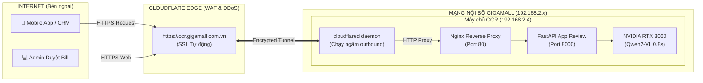

# HƯỚNG DẪN TRIỂN KHAI CLOUDFLARE TUNNEL CHO HỆ THỐNG OCR BILL
> **Dành cho:** Kỹ thuật viên hệ thống, DevOps, Quản trị viên Gigamall  
> **Áp dụng cho:** Máy chủ Ubuntu 22.04 LTS (IP LAN: `192.168.2.4`)  
> **Mục tiêu:** Public an toàn toàn bộ API và Dashboard OCR ra Internet với HTTPS miễn phí, **không cần mở Port trên Router (Zero Port Forwarding)**.

---

## 1. TẠI SAO NÊN DÙNG CLOUDFLARE TUNNEL?

Trong môi trường thực tế tại Gigamall:
- IP Public `14.161.34.37` đang chuyển tiếp Port 80 về server IIS nội bộ khác.
- Việc mở port thủ công trên Router đòi hỏi quyền quản trị thiết bị mạng và tiềm ẩn rủi ro lộ IP thật, tấn công DDoS.

**Cloudflare Tunnel (`cloudflared`) giải quyết triệt để vấn đề này:**
1. **Không cần mở port trên Router**: Máy chủ chủ động tạo kết nối mã hóa chiều ra (outbound) tới mạng lưới Anycast toàn cầu của Cloudflare qua cổng 443.
2. **Miễn phí chứng chỉ SSL/TLS**: Tự động kích hoạt HTTPS (`https://ocr.gigamall.com.vn`), hỗ trợ HTTP/2 và HTTP/3.
3. **Bảo mật tối đa**: Che giấu hoàn toàn IP Public thật (`14.161.34.37`) và IP nội bộ (`192.168.2.4`).
4. **Phân quyền truy cập thông minh**: Có thể bật Cloudflare Zero Trust Access để bảo vệ trang Review Dashboard của Admin (bắt đăng nhập OTP qua Email/Google) trong khi vẫn mở thông API upload cho Mobile/CRM.

---

## 2. KIẾN TRÚC HOẠT ĐỘNG



---

## 3. CÁCH 1: TRIỂN KHAI NHANH QUA CLOUDFLARE DASHBOARD (KHUYẾN NGHỊ)

Đây là cách trực quan, hiện đại và dễ quản lý nhất thông qua giao diện Web của Cloudflare Zero Trust.

### Bước 1: Chuẩn bị Domain trên Cloudflare
1. Đăng nhập vào [Cloudflare Dashboard](https://dash.cloudflare.com/).
2. Đảm bảo tên miền của bạn (ví dụ: `gigamall.com.vn` hoặc một domain phụ) đã được trỏ NameServer về Cloudflare.

---

### Bước 2: Tạo Tunnel trên Cloudflare Zero Trust
1. Truy cập mục **Zero Trust** trên menu trái (hoặc vào thẳng [one.dash.cloudflare.com](https://one.dash.cloudflare.com/)).
2. Vào menu: **Networks** $\rightarrow$ **Tunnels**.
3. Bấm **Add a tunnel** $\rightarrow$ Chọn loại **Cloudflare (Recommended)** $\rightarrow$ Bấm **Next**.
4. Đặt tên cho Tunnel: ví dụ `gigamall-ocr-production` $\rightarrow$ Bấm **Save tunnel**.

---

### Bước 3: Cài đặt Connector lên Máy chủ Ubuntu
Cloudflare sẽ hiển thị lệnh cài đặt tự động cho hệ điều hành **Debian 64-bit**.  
Bạn chỉ cần SSH vào máy chủ (`14.161.34.37` user `msa`) và chạy lệnh được cung cấp (dạng như sau):

```bash
# 1. Tải và cài đặt gói cloudflared deb chính hãng
curl -L --output cloudflared.deb https://github.com/cloudflare/cloudflared/releases/latest/download/cloudflared-linux-amd64.deb
sudo dpkg -i cloudflared.deb

# 2. Đăng ký và kích hoạt Tunnel Service bằng Token của bạn
# (Thay <YOUR_TUNNEL_TOKEN> bằng mã Token do Cloudflare cấp trong trang giao diện)
sudo cloudflared service install <YOUR_TUNNEL_TOKEN>

# 3. Khởi động và kiểm tra trạng thái
sudo systemctl start cloudflared
sudo systemctl status cloudflared
```
*Ngay khi chạy xong, trên màn hình Cloudflare sẽ báo trạng thái **Connected** (màu xanh).*  
Bấm **Next** để chuyển sang cấu hình Route.

---

### Bước 4: Cấu hình Public Hostname (Tên miền truy cập)
Trong tab **Public Hostnames**:
1. **Subdomain**: Nhập subdomain mong muốn (ví dụ: `ocr` hoặc `api-ocr`).
2. **Domain**: Chọn tên miền chính của bạn (ví dụ: `gigamall.com.vn`).
3. **Type**: Chọn `HTTP`.
4. **URL**: Nhập `localhost:80` (hoặc `127.0.0.1:80` - Cổng Nginx đang chạy).
5. Bấm **Save tunnel**.

**XONG!** Lúc này hệ thống OCR đã có thể truy cập toàn cầu qua địa chỉ:
$$\text{\bf https://ocr.gigamall.com.vn}$$

---

## 4. CÁCH 2: DÙNG THỬ NGAY LẬP TỨC (QUICK TUNNEL - MIỄN PHÍ KHÔNG CẦN DOMAIN)

Nếu bạn chưa kịp đăng ký hoặc trỏ domain, bạn có thể tạo ngay một **Quick Tunnel** tạm thời có HTTPS chỉ trong **10 giây**:

```bash
# SSH vào máy chủ:
ssh msa@14.161.34.37

# Chạy tunnel tạm thời trỏ vào Nginx port 80:
cloudflared tunnel --url http://localhost:80
```

Terminal sẽ in ra một liên kết ngẫu nhiên có đuôi `.trycloudflare.com`, ví dụ:
```text
+-----------------------------------------------------------------------+
|  Your quick Tunnel has been created! Visit it at:                    |
|  https://quick-tiger-alpha.trycloudflare.com                          |
+-----------------------------------------------------------------------+
```
Bạn có thể mở ngay liên kết đó trên điện thoại hoặc trình duyệt để test bóc tách hóa đơn.

---

## 5. CẤU HÌNH BẢO MẬT NÂNG CAO (ZERO TRUST ACCESS)

Để đảm bảo an toàn tuyệt đối cho hệ thống CRM:
- **API Upload (`/api/v1/bills/upload`)**: Cần mở công khai để Mobile App và Backend CRM đẩy ảnh vào.
- **Trang Quản trị Duyệt Bill (`/`)**: Cần bảo vệ để chỉ nhân viên Gigamall mới có quyền truy cập.

### Thiết lập Cloudflare Access Policy:
1. Vào Cloudflare Zero Trust $\rightarrow$ **Access** $\rightarrow$ **Applications** $\rightarrow$ **Add an application** $\rightarrow$ Chọn **Self-hosted**.
2. Đặt tên: `GigaMall OCR Dashboard`.
3. Application domain: `ocr.gigamall.com.vn` (Path: để trống hoặc `/`).
4. Thêm chính sách (Policy):
   - **Rule 1 (Protect Web UI)**: Yêu cầu đăng nhập Email có đuôi `@gigamall.com.vn` hoặc OTP code.
   - **Rule 2 (Bypass cho API)**: Thêm rule Bypass đối với đường dẫn:
     - `ocr.gigamall.com.vn/api/*` $\rightarrow$ Action: **Bypass** (để CRM/Mobile gọi không bị chặn màn hình đăng nhập).

---

## 6. KIỂM THỬ KẾT NỐI SAU KHI TRIỂN KHAI

Sau khi gán domain thành công (ví dụ `https://ocr.gigamall.com.vn`), kiểm thử các API:

### 1. Kiểm tra Health Check:
```bash
curl -i https://ocr.gigamall.com.vn/api/health
```
**Kết quả mong đợi:**
```json
HTTP/2 200 OK
content-type: application/json

{"status":"ok","timestamp":"2026-10-21T15:30:00"}
```

---

### 2. Kiểm tra Upload Bill (Fast Save < 0.1s):
```bash
curl -X POST https://ocr.gigamall.com.vn/api/v1/bills/upload \
     -F "file=@hoa_don_test.jpg" \
     -F "async_ocr=true"
```
**Kết quả mong đợi:**
```json
{
  "success": true,
  "bill_id": 109,
  "filename": "crm_20261021_..._hoa_don_test.jpg",
  "save_latency_seconds": 0.095,
  "message": "Ảnh đã lưu an toàn xuống đĩa máy chủ trong 0.095s. AI đang chạy bóc tách ngầm."
}
```

---

## 7. LỆNH QUẢN TRỊ & KHẮC PHỤC SỰ CỐ TRÊN SERVER

```bash
# Kiểm tra dịch vụ Cloudflare Tunnel
sudo systemctl status cloudflared

# Khởi động lại Cloudflare Tunnel
sudo systemctl restart cloudflared

# Xem log kết nối tunnel trực tiếp
sudo journalctl -u cloudflared -f

# Kiểm tra log Nginx tiếp nhận request từ Cloudflare
sudo tail -f /var/log/nginx/access.log
```

---
*Tài liệu được khởi tạo và cấu hình tương thích 100% với môi trường Ubuntu 22.04 LTS & NVIDIA RTX 3060.*
